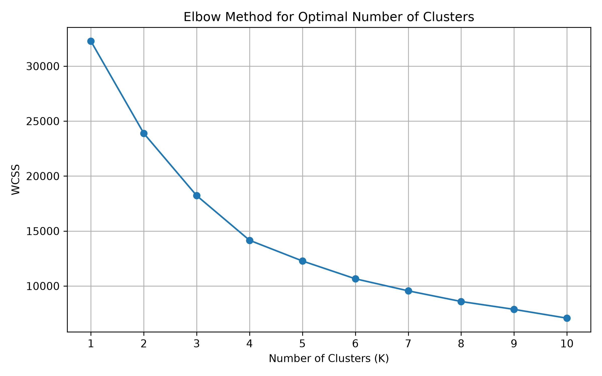
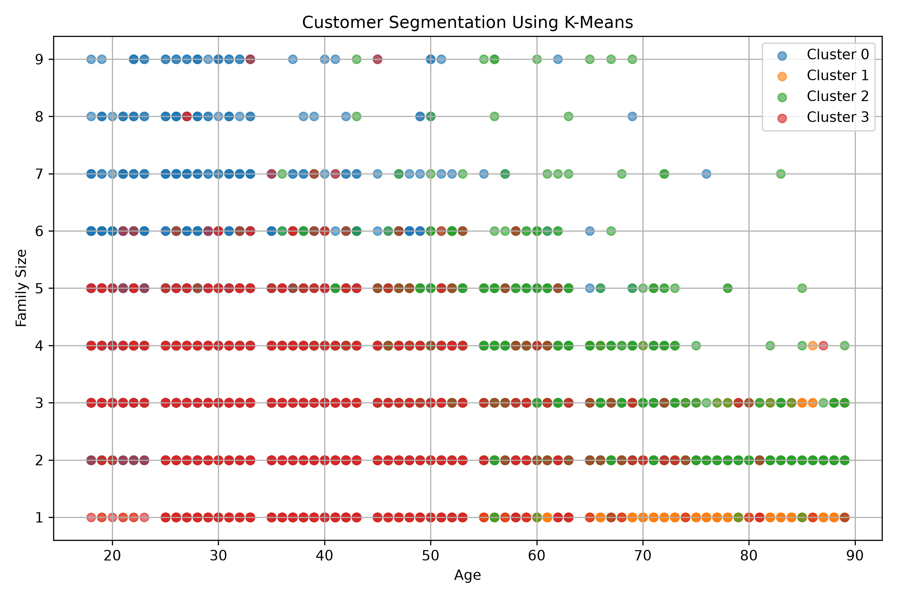
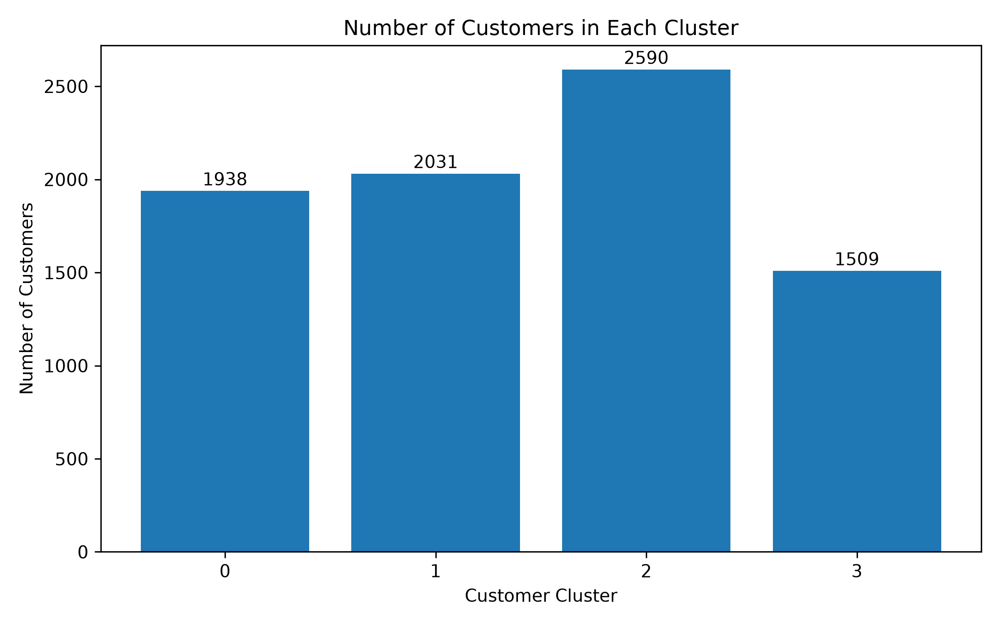

# Customer Segmentation Analysis

## Project Overview
This project uses K-Means Clustering to group customers into meaningful segments based on their demographic details and spending scores.

## Dataset
- **Source:** Kaggle – Customer Segmentation
- **File:** `Train.csv`
- **Total Records:** 8,068
- **Original Features:** 11 columns

## Tools and Technologies
- Python
- Pandas and NumPy
- Matplotlib
- Scikit-learn
- Jupyter Notebook

## Project Workflow
1. Loaded and explored the customer dataset.
2. Identified and handled missing values.
3. Converted spending scores into numerical values.
4. Selected Age, Work Experience, Family Size, and Spending Score as clustering features.
5. Standardized the selected features using StandardScaler.
6. Used the Elbow Method to examine the suitable number of clusters.
7. Applied K-Means clustering with four clusters.
8. Analyzed the customer profiles and visualized the results.

## Customer Segments
The analysis grouped 8,068 customers into four clusters:

| Cluster | Number of Customers |
|---|---:|
| Cluster 0 | 1,938 |
| Cluster 1 | 2,031 |
| Cluster 2 | 2,590 |
| Cluster 3 | 1,509 |

- **Cluster 0:** Younger customers with mostly low spending scores.
- **Cluster 1:** Older customers with low spending scores.
- **Cluster 2:** Customers with average or high spending scores.
- **Cluster 3:** Customers with comparatively higher work experience.

## Visualizations
### 1. Elbow Method

### 2. Customer Clusters

### 3. Customers per Cluster

## Conclusion
K-Means clustering grouped customers into four segments using age, work experience, family size, and spending score. These segments may help businesses plan targeted marketing and personalized customer engagement strategies.

## Limitations
The analysis uses demographic information and spending-score categories. It does not include transaction-level data, purchase amounts, or purchase frequency. Therefore, the segments should not be interpreted as direct measures of customer revenue or lifetime value.